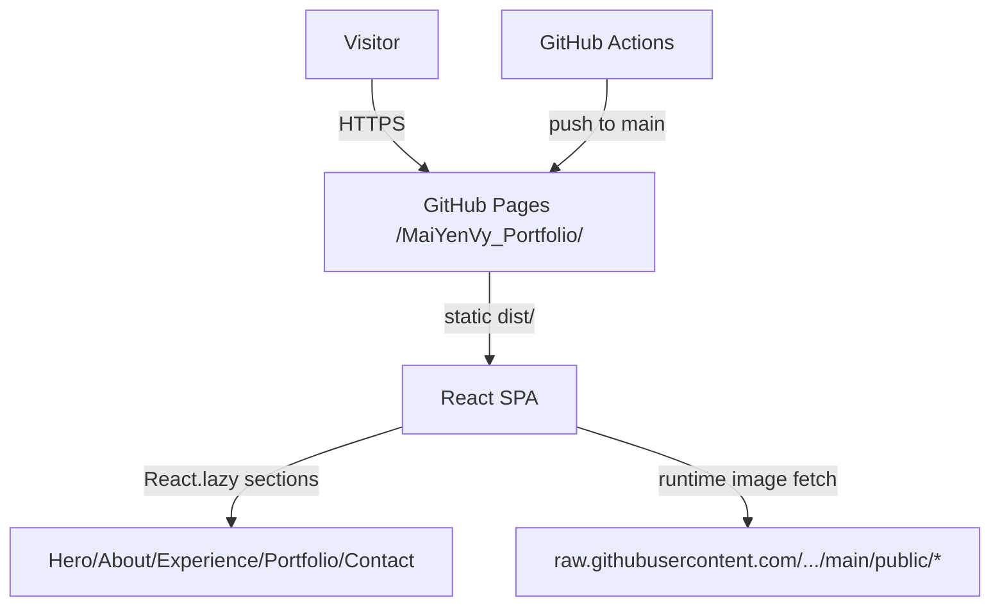

# PROJECT CONTEXT — Mai Yến Vy Portfolio

> **This file is the authoritative long-term project memory.** Every AI coding agent MUST read it before starting work and MUST update it after every meaningful change. See `MANDATORY AI AGENT OPERATING RULES` at the bottom.
>
> Detailed audit evidence lives in `docs/project-intelligence/` (14 documents). This file summarizes verified state and tracks change history — it intentionally does not duplicate those docs.
>
> **Last verified:** 2026-11-05 · **Last context update:** 2026-11-05 (Dreamy garden night + perf ambient fireflies — pushing)

---

## A. PROJECT IDENTITY

| Field | Value |
|---|---|
| Project name | `portfolio-website` (repo: `MaiYenVy_Portfolio`) |
| Purpose | Personal portfolio SPA for **Mai Yến Vy**, Communications / Cultural Studies student (ĐH KHXH&NV – ĐHQG TP.HCM) |
| Product description | Vietnamese-language single-page site: Hero → About → Experience timeline → Portfolio (filterable grid, lightbox, video modal) → Contact. Static content only — no backend, DB, auth, or forms. |
| Target audience | Recruiters, professors, collaborators, event organizers |
| Main technologies | React 18, Vite 5, Tailwind CSS 3, Framer Motion 11, lucide-react, GitHub Pages + Actions |
| Repository structure | Flat Vite project: `index.html`, `src/` (7 files), `public/` (media), configs at root, `docs/` |
| Production URL | `https://LLLVPN4423.github.io/MaiYenVy_Portfolio/` (inferred from repo name + Pages workflow; not fetched this session) |
| Deployment platform | GitHub Pages via `.github/workflows/deploy.yml` |
| Development stage | Functional MVP deployed; content partially real, partially placeholder |

## B. SYSTEM ARCHITECTURE

- **Entry chain:** `index.html` → `src/main.jsx` (StrictMode) → `src/App.jsx` → eager `Navbar` + 5 lazy sections, each in its own `Suspense`.
- **Routing:** none. Anchor links only (`#home #about #experience #portfolio #contact` — all ids verified present). Smooth scroll via CSS.
- **State:** local `useState` only. No router/state library. Portfolio owns filter/page/modal state.
- **Styling:** Tailwind utilities + midnight/royal palette; fonts: EB Garamond (display), Great Vibes (script), Source Sans 3 (body) — all Vietnamese-capable. `src/index.css` materials + glass/kingdom atmosphere.
- **Asset management — CRITICAL:** Images are NOT bundled. All thumbnails/full images/portrait are fetched at runtime from `https://raw.githubusercontent.com/LLLVPN4423/MaiYenVy_Portfolio/main/public/<flat-filename>`. The 18 photos exist as flat files at `public/` root specifically so these URLs resolve; duplicates also exist under `public/media-selected/`. `public/media/` (~1.1 GB, 300 files) and `public/videos/` (~1.3 GB) are **gitignored** — local-only.
- **Build:** `vite build` copies ALL of `public/` → `dist/` (2.5 GB locally → ~3m36s build). CI never sees untracked dirs.
- **Deploy:** push/PR-merge to `main` (or manual `workflow_dispatch`/`repository_dispatch`) → `npm ci` → `npm run build` → redundant root-image copy step → `actions/deploy-pages`.
- **External runtime deps:** raw.githubusercontent.com (all imagery — single point of failure), images.unsplash.com (4 mock thumbs), Google Fonts, placeholder social URLs.
- Full detail: `docs/project-intelligence/ARCHITECTURE.md`, `DATA_FLOW.md`, `API_REFERENCE.md`.

## C. FEATURE STATUS

| Feature | Status | Notes | Last Updated |
|---|---|---|---|
| Hero section | COMPLETE | Soft princess midnight: starfield/moon/castle, soft parchment opening page, soft-frame portrait; anims gated on intro completion | 2026-11-05 |
| Navbar + anchor nav | COMPLETE | Midnight navy, crest wordmark, scroll-spy, champagne/blush hairlines | 2026-11-05 |
| About / bio / skills | COMPLETE | Soft StorybookPage bio, rounded RoyalPanel skills, night contact card | 2026-11-05 |
| Experience timeline | COMPLETE | Soft gold spine + glowing round medallions, parchment RoyalPanel cards | 2026-11-05 |
| Portfolio filtering | COMPLETE | Soft pill filters; "Tất cả" still caps 2/category (TD-05) | 2026-11-05 |
| Portfolio pagination | COMPLETE | Soft royal controls | 2026-11-05 |
| Lazy image loading | COMPLETE | + onError fallback | 2026-11-05 |
| Image lightbox | COMPLETE | Soft-frame modal on midnight overlay, Esc-close, scroll-lock, fireflies | 2026-11-05 |
| Video playback | **BROKEN** | `public/videos/` gitignored → 404 on Pages; works locally; error UI wired | 2026-11-05 |
| Video intro | COMPLETE (local) | Scale-based bloom (measured FLIP); auto handoff via phase timers (immersing→transition→done). Hollow soft-frame. TD-16 still blocks deploy; no 9:16 mobile cut | 2026-11-05 |
| Portfolio section UI | COMPLETE | Midnight Royal Vintage Storybook plates: soft-frame + filigree, manuscript captions, chapter ribbon filters, storybook lightbox | 2026-11-05 |
| Contact info | COMPLETE | Royal letter panel; mailto/tel/address verified channels only | 2026-11-05 |
| Social links | NOT IMPLEMENTED | Placeholder `yourprofile` links REMOVED (were fake); re-add only with real URLs | 2026-11-05 |
| Creator/design portfolio items | PARTIAL | Still Unsplash mockups, now badged "Minh họa" | 2026-11-05 |
| SEO/meta | PARTIAL | Title fixed, favicon + description added; no OG/Twitter tags | 2026-11-05 |
| Accessibility | PARTIAL | Modals now Esc-close + scroll-lock + aria; focus trap still absent | 2026-11-05 |
| Backend/API/DB | NOT IMPLEMENTED | By design — static site | 2026-11-05 |
| Tests/lint/tooling | NOT IMPLEMENTED | No test framework, ESLint, or Prettier | 2026-11-05 |

## D. CURRENT PROJECT STATE

- **Git branch:** `main` (only branch; == `origin/main`)
- **HEAD commit:** `5b0010c` "Add Experience section with timeline layout for work history" (2026-08-25)
- **Working tree:** dirty — local redesign uncommitted (Intro, Ornaments, all sections, palette, docs/AGENTS/PROJECT_CONTEXT untracked or modified)
- **Latest completed phase:** Soft Disney-princess polish + intro fullscreen bloom (CHANGE-009)
- **Implementation state:** Midnight Royal Vintage Storybook (dreamy palace-garden night, ambient fireflies, royal frames, beanstalk experience, cinematic intro). Pushing to origin/main.
- **Known bugs:** portfolio video modal 404 in production (TD-02); intro MP4 gitignored under `public/media/` (TD-16 — will 404 on Pages until relocated); mock items badged "Minh họa" (TD-10)
- **Outstanding issues:** see Section H (TD-01…TD-17; TD-08/09/11 resolved)
- **Blockers:** TD-16 for intro on Pages; TD-02 for portfolio videos
- **Last successful validation:** prior build PASS (CHANGE-011); perf/garden changes are CSS/JS-only this pass
- **Next recommended task:** relocate intro MP4 out of gitignored `public/media/` (or add exception) so Pages serves the intro

## E. TECHNICAL CONVENTIONS

Verified from source:

- **Language:** plain JSX (no TypeScript, no PropTypes). ES modules (`"type": "module"`).
- **Components:** functional, `export default`, PascalCase files in `src/components/`.
- **Styling:** Tailwind utility classes only; midnight/royal tokens; headings `font-display` (EB Garamond), script `font-script` (Great Vibes), body `font-sans` (Source Sans 3) — all Vietnamese-capable.
- **Animation pattern:** Framer Motion — `initial`/`whileInView`/`viewport={{ once: true }}` for sections; `whileHover`/`whileTap` for buttons; `AnimatePresence` for modals/menus.
- **Icons:** `lucide-react`, sized via `size={n}` prop.
- **Content editing:** all copy lives in `config`/`projects`/`experiences` arrays inside each component — edit JSX constants, commit, push to deploy.
- **Adding images:** place flat file at `public/` root, add filename to the matching array in `Portfolio.jsx` (URL template is fixed — see Section B). Videos currently NOT deployable.
- **Commits:** short imperative messages ("Add Experience section…", "Fix media files copy step…").
- **Commands:** `npm run dev` (port 3000, auto-open), `npm run build`, `npm run preview`. No test/lint scripts exist.
- **Gitignore conventions:** `public/media/`, `public/videos/`, `src_backup`, `components_corrupted_ignore`, `dist`, `node_modules` are ignored; `media-selected/` and root images are explicitly un-ignored.
- **Error handling:** minimal — no error boundaries, no global handler; `LazyImage` shows gray pulse until `onLoad`.

## F. IMPORTANT FILES AND MODULES

| File | Responsibility | Edit carefully? |
|---|---|---|
| `index.html` | Shell, fonts, title (has `[brackets]` bug) | Yes — `lang`, fonts, title |
| `src/main.jsx` | Mount root | Rarely |
| `src/App.jsx` | Layout + lazy-loading + footer | Yes — Suspense boundaries |
| `src/index.css` | Tailwind directives, base typography, scrollbar | Styling changes |
| `tailwind.config.js` | Palette + content globs (excludes corrupted dirs) | Yes — missing glob = unstyled classes |
| `vite.config.js` | `base` path, dev port, watch ignores | **YES — `base` is load-bearing for Pages** |
| `src/components/Navbar.jsx` | Nav + mobile menu | Low risk |
| `src/components/Hero.jsx` | Hero copy | Content only |
| `src/components/About.jsx` | Bio/skills + portrait raw URL | Yes — image URL pattern |
| `src/components/Experience.jsx` | Timeline data | Content only |
| `src/components/Portfolio.jsx` | Filters, pagination, modals, hooks, ALL project data + image URL templates | **Highest-risk file — media architecture lives here** |
| `src/components/Contact.jsx` | Contact config incl. placeholder socials | Content only |
| `.github/workflows/deploy.yml` | Pages pipeline | Yes — verify deploy after edits |
| `.gitignore` | Controls what media reaches git/CI | Yes — determines deployable assets |
| `public/` root images | Canonical images for raw GitHub URLs | Do not rename/move without updating all URL references |
| `docs/project-intelligence/` | 14-doc audit knowledge base | Reference, keep in sync |

Untracked local-only dirs (`src_backup/`, `src_new/` empty, `components_corrupted_ignore/`, `public/media/`, `public/videos/`, `dist/`, `node_modules/`) — do not commit or delete casually.

## G. ARCHITECTURAL DECISIONS

| ID | Date | Context | Decision | Reason | Alternatives | Consequences |
|---|---|---|---|---|---|---|
| ADR-001 | 2026-07-27 | Images too large / Pages deployment issues | Serve images via `raw.githubusercontent.com` hotlinks to files committed at `public/` root | "Bypass deployment issues" (commit 256ee4e) | Bundle into dist; external CDN | Repo-coupling SPOF; works today |
| ADR-002 | 2026-07-27 | Repo-name deployment | `base: '/MaiYenVy_Portfolio/'` in vite config | GitHub Pages project-site subpath | Custom domain / user-site root | All asset URLs prefixed; required |
| ADR-003 | project start | Content management | Hardcoded JSX constants, no CMS/backend | Personal portfolio scale | Headless CMS, markdown | Content edits require code commits |
| ADR-004 | project start | Styling | Tailwind utility-first + custom palette tokens | Rapid styling, small bundle | CSS modules/styled-components | Consistent look; palette centralized in config |
| ADR-005 | 2026-07-27 | Media curation | Only 18 "selected" images committed (~84 MB); full archive stays local/gitignored | GitHub repo size practicality | Commit everything | Raw URLs only cover selected set; videos undeployable |
| ADR-006 | 2026-08-25 | Content expansion | Experience section as vertical timeline component | Showcase work history | Merge into About | New section + nav item added |

## H. KNOWN ISSUES AND TECHNICAL DEBT

Active issues (mirrors `docs/project-intelligence/TECHNICAL_DEBT.md`; remove only after verified fix — keep resolution history):

| ID | Description | Severity | Files | Status | Resolution |
|---|---|---|---|---|---|
| TD-01 | ~2.5 GB local `public/` → 3m36s builds copying to dist | MEDIUM | `public/`, `vite.config.js` | OPEN | Move archives out of publicDir |
| TD-02 | Videos gitignored → 404 on production | HIGH | `Portfolio.jsx:189,198`, `.gitignore` | OPEN | External host or remove category |
| TD-03 | Project generators duplicated; images stored twice (root + media-selected) | MEDIUM | `Portfolio.jsx:117-145` | OPEN | Single generator + canonical dir |
| TD-04 | All imagery depends on raw.githubusercontent.com | MEDIUM | `Portfolio.jsx`, `About.jsx` | OPEN | Same-origin paths after size strategy |
| TD-05 | "Tất cả" filter caps 2/category | LOW | `Portfolio.jsx:221-235` | OPEN | Show all or add view-more |
| TD-06 | Dead dirs: `src_backup/`, `src_new/`, `components_corrupted_ignore/` | LOW | repo root | OPEN | Archive/delete (untracked) |
| TD-07 | README stale (template-era docs) | LOW | `README.md` | OPEN | Update or point to docs/ |
| TD-08 | ~~Title has `[Mai Yến Vy]` brackets~~ | — | `index.html` | **RESOLVED 2026-11-05** | Title now "Mai Yến Vy — Portfolio" |
| TD-09 | ~~Social links are `yourprofile` placeholders~~ | — | `Contact.jsx` | **RESOLVED 2026-11-05** | Placeholders removed; only verified mailto/tel/address remain. Re-add real URLs when provided |
| TD-10 | Unsplash mockups w/ fake metrics as real work | MEDIUM | `Portfolio.jsx` | OPEN (mitigated) | Now badged "Minh họa"; still needs real content or removal |
| TD-11 | ~~`videoError` state unused~~ | — | `Portfolio.jsx` | **RESOLVED 2026-11-05** | Wired to `<video onError>`; shows "Video tạm thời không khả dụng" fallback panel |
| TD-12 | Experience not reverse-chronological | LOW | `Experience.jsx` | OPEN | Reorder |
| TD-13 | No lint/format/test tooling | MEDIUM | repo root | OPEN | Add ESLint/Prettier + smoke test |
| TD-14 | Redundant media-copy step in deploy.yml | LOW | `.github/workflows/deploy.yml:40-45` | OPEN | Remove after verifying |
| TD-15 | No error boundary; OG tags absent (favicon + description added) | LOW | `App.jsx`, `index.html` | OPEN (partial) | Add boundary + OG meta |
| TD-16 | Intro video `public/media/fairytale-intro.mp4` is inside gitignored `public/media/` → will 404 on Pages | HIGH (for deploy) | `public/media/`, `.gitignore` | OPEN (superseded) | New intro uses `midnight-royal-intro-{desktop,mobile}.mp4` in same dir — same gitignore problem applies once files arrive; relocate or add exception before deploy |
| TD-17 | New intro video assets missing: `public/media/midnight-royal-intro-desktop.mp4` (16:9) and `-mobile.mp4` (9:16) do not exist | HIGH (for feature) | `Intro.jsx`, `public/media/` | PARTIALLY RESOLVED | Desktop asset now exists (copied from owner's `gemini_generated_video_a35a9bd3.mp4`); NO dedicated 9:16 mobile cut — same 16:9 film letterboxed on mobile. If owner supplies a portrait cut, add `public/media/midnight-royal-intro-mobile.mp4` and point `MOBILE_SRC` at it |

## I. DEVELOPMENT ROADMAP

**Completed:** initial build, GitHub Pages deploy, media migration to raw-URL strategy, Experience section, full audit docs.

**Current:** none in progress.

**Pending (priority order — detail in `docs/project-intelligence/ROADMAP.md`):**

- **P0:** TD-02 video fix · TD-09 social links · TD-10 mock content · TD-08 title
- **P1:** TD-01 media reorg (sub-minute builds) · TD-04 same-origin images · error boundary (part of TD-15) · TD-14 workflow cleanup
- **P2:** modal a11y · "Tất cả" UX · OG/favicon · experience ordering
- **P3:** lint/format/tests · dead-dir cleanup · README refresh · dedupe generators · SHA-pin Actions

**Blocked:** none. Owner input needed for: real social URLs, video hosting preference, consent re: published phone/address.

## J. AGENT CHANGE HISTORY

<!-- Append-only. Format per entry below. Never delete or rewrite entries; corrections are new entries. -->

### CHANGE-001 — 2026-11-05
- **Agent/IDE:** Devin Desktop (SWE-2 Flash)
- **Task:** Full project discovery & technical audit (user-requested master prompt)
- **Type:** Documentation / Investigation
- **Status:** COMPLETED
- **Files created:** `docs/project-intelligence/` — 14 files (PROJECT_OVERVIEW, ARCHITECTURE, CODEBASE_MAP, FEATURE_INVENTORY, DATA_FLOW, DATABASE_AND_STORAGE, API_REFERENCE, SECURITY_AUDIT, QUALITY_AND_TEST_REPORT, TECHNICAL_DEBT, DEVELOPMENT_HISTORY, ROADMAP, AGENT_HANDOVER, EVIDENCE_REGISTER)
- **Changes:** Read all source, configs, git history; ran `npm run build` (PASS, ~3m36s) and `npm audit --omit=dev` (0 vulnerabilities). No source code modified.
- **Key findings:** video playback broken in production (gitignored assets); all imagery hotlinked from raw.githubusercontent.com; placeholder social links; Unsplash mock projects; 2.5 GB untracked local media; no tests/lint.
- **Validation:** build PASS; audit clean; git state verified clean on `main` @ `5b0010c`.
- **Remaining issues:** all TD-01…TD-15 OPEN; P0 batch recommended next.
- **Related roadmap tasks:** establishes baseline for all.

### CHANGE-002 — 2026-11-05
- **Agent/IDE:** Devin Desktop (SWE-2 Flash)
- **Task:** Create permanent project context & cross-IDE agent memory system
- **Type:** Documentation / Tooling
- **Status:** COMPLETED
- **Files created:** `PROJECT_CONTEXT.md` (this file), `AGENTS.md`
- **Changes:** Consolidated audit findings into living project memory; added mandatory agent operating rules; established append-only change history format.
- **Validation:** git status verified; no application source files modified.
- **Remaining issues:** none for this task.
- **Related roadmap tasks:** enables all future work tracking.

### CHANGE-003 — 2026-11-05
- **Agent/IDE:** Devin Desktop (SWE-2 Flash)
- **Task:** Enchanted Storybook → Royal Enchanted Storybook full UI redesign (two user commissions, same session)
- **Type:** Feature / Visual Redesign
- **Status:** COMPLETED locally — awaiting owner visual review; NOT pushed/deployed
- **Files created:** `src/components/Intro.jsx`, `src/components/decor/Ornaments.jsx`, `public/media/fairytale-intro.mp4` (copied from `D:\download\gemini_generated_video_a35a9bd3.mp4`, 5.4 MB, original untouched)
- **Files modified:** `index.html` (fonts Cormorant Garamond + Great Vibes, title fix, favicon, meta), `tailwind.config.js` (Royal palette: ivory #F5EBDD, cream #EADCCB, petal #C88FA8, sky #AFC8E0, lilac #B7A4D0, gold #C6A15B, gold-dark #A98242, bronze #76533D, rose #A96F8D, ink #57434C), `src/index.css` (engraved texture, gold-shimmer, reduced-motion), `src/App.jsx` (Intro mount, royal footer), `Navbar.jsx` (scroll-spy, gold rules), `Hero.jsx` (crown, framed portrait, deeper atmosphere), `About.jsx` (RoyalPanel cards), `Experience.jsx` (royal timeline), `Portfolio.jsx` (antique frame cards, framed modals, mock badges, Esc/scroll-lock/a11y, videoError UI, image onError fallback), `Contact.jsx` (royal letter panel, placeholder socials removed)
- **Changes:** Complete visual redesign to Royal Enchanted Storybook (Rococo × Regency × Fairytale). Intro video plays once/session inside ornate gold frame with pastel rose/blue backdrop; skip + reduced-motion + autoplay-fallback preserved.
- **Reason:** Owner-requested premium fairytale redesign; deeper, richer palette per second commission.
- **Validation:** All modules transform cleanly via dev server (HTTP 200 ×9); HMR clean, no errors. `npm run build` PASS (vite 5.4.21, 1835 modules, ~3m13s); `dist/media/fairytale-intro.mp4` confirmed copied. Visual/browser QA pending owner review — interactions verified by code inspection only.
- **Remaining issues:** TD-16 (intro video gitignored — must relocate before deploy); portfolio videos still 404 in prod (TD-02); mock items badged but still Unsplash; no OG tags; no error boundary.
- **Related roadmap tasks:** supersedes P0-3/P0-4 (done); P0-2 partially (socials removed, real URLs still needed).

### CHANGE-004 — 2026-11-05
- **Agent/IDE:** Devin Desktop (SWE-2 Flash)
- **Task:** Midnight Royal Fairytale redesign — evolve Royal Storybook into dark royal-palace theme with antique parchment content panels
- **Type:** Feature / Visual Redesign
- **Status:** COMPLETED locally — awaiting owner visual review; NOT pushed/deployed. Intro BLOCKED: new video assets missing (see TD-17)
- **Files created:** none new (reused `Intro.jsx`, `decor/Ornaments.jsx` heavily extended)
- **Files modified:** `tailwind.config.js` (midnight palette: midnight #090B16, navy #10182B, royal #192944, moon #263B5B, gold #C6A15B, champagne #E2CA91, rose/pink/lavender accents, ivory/cream parchment, ink #4A352A paper text, night #EDEAF2 dark-surface text), `src/index.css` (parchment material, paper-edge vignette, starfield, firefly/petal animations), `src/components/decor/Ornaments.jsx` (rewritten: AntiqueParchment/RoyalManuscript/StorybookPage/RoyalLetter/IllustratedPaperFrame/AntiquePhotoFrame, RoyalCrest/CrownMark/CastleSilhouette, FireflyField/DriftingPetals/MoonGlow/NightBackdrop, dual-surface RoyalPanel/SectionHeading), `src/components/Intro.jsx` (responsive `<source media>` desktop/mobile, midnight backdrop, fade-to-black ending, `onComplete` callback, new session key `midnight-intro-seen`), `src/App.jsx` (midnight shell, introComplete state → Hero, midnight footer), all 6 section components restyled.
- **Changes:** Global theme flipped to midnight royal navy/black; all content surfaces became antique parchment panels (paper grain, aged-tone gradients, double gold borders, corner flourishes, drop-cap bio). Added starfields, moon glows, golden fireflies, drifting petals, castle silhouette, royal crest/crown motifs. Portfolio cards = antique illustrated frames + parchment caption slips. Hero gates its reveal on intro completion.
- **Reason:** Owner-requested evolution to Midnight Royal Fairytale (antique book × classic princess × enchanted palace).
- **Validation:** All 9 modules transform cleanly (HTTP 200). Intro video files confirmed ABSENT (TD-17 — dev-server 200s were SPA HTML fallback, Content-Type text/html). `npm run build` PASS (vite 5.4.21, 1835 modules, ~3m08s). Visual QA pending owner review.
- **Remaining issues:** TD-17 (intro assets missing — owner action); TD-16 (gitignored media dir blocks deploy); TD-02 (portfolio videos 404 in prod); TD-10 mock badges remain; no OG tags; no error boundary.
- **Related roadmap tasks:** visual redesign phase; P0-2/P0-3 done; media issues remain.

### CHANGE-005 — 2026-11-05
- **Agent/IDE:** Devin Desktop (SWE-2 Flash)
- **Task:** "Living Antique Princess Storybook" refinement — chapter storytelling + storybook control components on the midnight base
- **Type:** Feature / Visual Refinement
- **Status:** COMPLETED locally — awaiting owner visual review; NOT pushed/deployed. Intro still BLOCKED (TD-17)
- **Files created:** none
- **Files modified:** `src/components/decor/Ornaments.jsx` (new `RoyalButton` gold/parchment/night variants, `RoyalBadge`, `ChapterDivider`; `SectionHeading` gained `subtitle` prop), `src/App.jsx` (ChapterDivider scene-breaks between all sections), `Hero.jsx` (CTAs → RoyalButton), `Portfolio.jsx` (filter chips → parchment/royal storybook style, category+mock badges → RoyalBadge, pagination → RoyalButton, lightbox now stores project and shows parchment title slip), `Experience.jsx` (period labels → RoyalBadge night), `Contact.jsx` (eyebrow "chương cuối" + subtitle, CTA → RoyalButton)
- **Changes:** Storytelling layer added on top of midnight base — sections now read as chapters (opening → chương một → hai → ba → cuối), with ornamental gold/diamond scene dividers between them. Buttons, badges, filters and pagination converted to reusable royal storybook controls. Lightbox gained a parchment caption slip.
- **Reason:** Owner-requested second-pass refinement emphasizing chapter narrative, unified storybook component language, and parchment confined strictly to content components (verified: all section backgrounds remain dark navy/midnight).
- **Validation:** All edited modules transform cleanly (HTTP 200 ×6). `npm run build` PASS (vite 5.4.21, 1835 modules, ~2m52s). Visual QA pending owner review.
- **Remaining issues:** TD-17 intro assets still missing; TD-16 media gitignore; TD-02 portfolio videos; TD-10 mock badges remain; no OG tags; no error boundary.
- **Related roadmap tasks:** visual redesign phase; media issues remain.

### CHANGE-006 — 2026-11-05
- **Agent/IDE:** Devin Desktop (SWE-2 Flash)
- **Task:** Fix intro playback flow (portfolio opened before video finished) + deepen vintage parchment material
- **Type:** Bug Fix / Visual Refinement
- **Status:** COMPLETED locally — awaiting owner visual review; NOT pushed/deployed
- **Files created:** `public/media/midnight-royal-intro-desktop.mp4` (copy of owner's `gemini_generated_video_a35a9bd3.mp4`; original untouched)
- **Files modified:** `src/components/Intro.jsx` (rewritten as explicit state machine), `src/index.css` (parchment: deeper antique base #F1E4C9, laid-fiber layer, foxing spots, top-light sheen + stronger edge vignette), `src/components/Hero.jsx` (opening panel now uses shared `StorybookPage` material)
- **Changes:** ROOT CAUSE of intro bug: `Intro.jsx` pointed at `midnight-royal-intro-{desktop,mobile}.mp4` which did not exist → video `error` event fired `finish()` instantly → portfolio revealed immediately. Rewrote Intro as event-driven state machine: loading → ready (canplay) → playing ('playing' event) → transition (ONLY on 'ended' or Skip; fade driven by onAnimationComplete, no fixed timeout) → done → onComplete. Session marked seen ONLY on ended/skip — not on mount/load/autoplay-block/error. Autoplay rejection → "Xem intro" tap button; media error → fallback panel with "Thử lại"/"Vào trang ngay" (never a dead end); Skip always keyboard-accessible; guards against duplicate transitions via finishedRef.
- **Reason:** Owner reported intro skipped too early + parchment panels looked flat/modern in screenshot.
- **Validation:** Video serves 200 video/mp4 under base path; module transforms 200 ×3 + css 200. `npm run build` PASS (vite 5.4.21, 1835 modules, ~3m17s). Browser playback QA pending owner review.
- **Remaining issues:** TD-16 (media dir gitignored — intro won't deploy until relocated); no 9:16 mobile cut (TD-17 partial); TD-02 portfolio videos; TD-10 mocks; no OG tags; no error boundary.
- **Related roadmap tasks:** visual redesign phase; P0 intro correctness.

### CHANGE-007 — 2026-11-05
- **Agent/IDE:** Devin Desktop (SWE-2 Flash)
- **Task:** Fix false intro error state — video kept playing behind the error fallback
- **Type:** Bug Fix
- **Status:** COMPLETED locally — NOT pushed/deployed
- **Files modified:** `src/components/Intro.jsx` only
- **Changes:** `handleError` now ignores transient errors (`video.error === null` — e.g. one `<source>` failing while another succeeds) and pauses the element on fatal error; `beginTransition` pauses the video on Skip/ended-transition so playback never continues behind the fade or fallback.
- **Reason:** Owner reported error message shown while video still played behind the intro.
- **Validation:** Module transforms 200. Runtime playback QA pending owner review (hard refresh / clear `midnight-intro-seen` to replay).
- **Remaining issues:** unchanged (TD-16 deploy blocker, TD-17 partial mobile cut, TD-02, TD-10).

### CHANGE-008 — 2026-11-05
- **Agent/IDE:** Devin Desktop (SWE-2 Flash)
- **Task:** Update intro video asset (owner regenerated) + soften rigid geometry across all components
- **Type:** Asset Update / Visual Refinement
- **Status:** COMPLETED locally — NOT pushed/deployed
- **Files created/modified:** `public/media/midnight-royal-intro-desktop.mp4` + `fairytale-intro.mp4` overwritten with new owner render (6,354,598 bytes, md5 61b808e5…; original `D:\download\gemini_generated_video_a35a9bd3.mp4` untouched); `src/components/decor/Ornaments.jsx` (all paper/frame components rounded-[3px]/[4px] → rounded-2xl, inner rules → rounded-xl, RoyalButton → rounded-xl, RoyalBadge → rounded-full pill, diamond dividers → ring-and-dot motifs); `src/components/Portfolio.jsx` (cards rounded-2xl, image mat rounded-xl/inner rounded-lg); `src/components/Experience.jsx` (timeline node diamond → round medallion, bullet diamonds → dots)
- **Changes:** New intro video in place (same state machine, no code change needed). Geometry softened: no more sharp-cornered boxes — panels/cards/frames now have large soft radii while keeping double gold borders and filigree.
- **Reason:** Owner requested updated intro video and complained components/details felt "cứng nhắc" (rigid).
- **Validation:** All edited modules transform 200; video serves 200 video/mp4; `npm run build` PASS (vite 5.4.21, 1835 modules, ~2m59s). Visual QA pending owner review.
- **Remaining issues:** unchanged (TD-16, TD-17 partial, TD-02, TD-10).

### CHANGE-009 — 2026-11-05
- **Agent/IDE:** Cursor (Composer)
- **Task:** Soft Disney-princess style pass + intro fullscreen bloom at firefly/black ending
- **Type:** Feature / Visual Redesign
- **Status:** COMPLETED locally — NOT pushed/deployed
- **Files modified:** `tailwind.config.js` (softer pearl-gold/blush/lavender palette, `rounded-soft`/`softer`, `shadow-princess`/`glow`), `src/index.css` (softer parchment, `.soft-frame`, blush glow, gentler foxing), `src/components/Intro.jsx` (new phases expanding→immersing→transition: ~3.4s before end frame dissolves + film blooms to cover viewport + firefly immersion hold → fade into portfolio), `src/components/decor/Ornaments.jsx` (all frames → rounded-softer + soft pearl/blush borders; soft-frame photo frames; pill buttons), `Portfolio.jsx` / `Contact.jsx` / `Hero.jsx` / `About.jsx` / `Experience.jsx` / `Navbar.jsx` / `App.jsx` / `index.html` (remove remaining square radii, soft shadows)
- **Changes:** Colors no longer harsh antique-gold boxes; organic soft radii + blush mist. Intro no longer stays boxed at the firefly ending — expands fullscreen then reveals portfolio.
- **Reason:** Owner: frames still too square, colors too crude; wants to be "sucked into" the firefly realm at intro end before portfolio appears.
- **Validation:** `npm run build` PASS (vite 5.4.21, 1835 modules, ~3m02s). No automated tests/lint. Browser playback QA pending owner (clear `midnight-intro-seen` session key to replay).
- **Remaining issues:** TD-16 (media gitignore blocks deploy); TD-17 partial (no 9:16 mobile cut); TD-02; TD-10.
- **Related roadmap tasks:** visual redesign phase.

### CHANGE-010 — 2026-11-05
- **Agent/IDE:** Cursor (Composer)
- **Task:** Fix intro gold-gradient flash + long stall after video ends
- **Type:** Bug Fix
- **Status:** COMPLETED locally — NOT pushed/deployed (superseded by CHANGE-011 for handoff)
- **Files modified:** `src/components/Intro.jsx` only
- **Changes:** Hollow soft-frame (padding band). Shorter immersion/fade timers.
- **Reason:** Owner screenshot showed solid gold→pink gradient before playback; reported long hang after video.
- **Validation:** code inspection.
- **Remaining issues:** post-end freeze could still occur via timer cleanup bug (fixed in CHANGE-011).

### CHANGE-017 — 2026-11-05
- **Agent/IDE:** Cursor (Composer)
- **Task:** Dreamy palace-garden night backdrop + performance fix + push
- **Type:** Visual Refinement / Performance
- **Status:** COMPLETED — committing & pushing to origin/main
- **Files modified:** `src/index.css` (dreamy `.night-sky`/`.garden-mist`; removed `backdrop-filter` + sheen animation), `Ornaments.jsx` (cheap FireflyField; `AmbientFireflies`; NightBackdrop garden hedges, fireflies off by default), `App.jsx` (one shared ambient firefly layer ×28), Hero/About/Experience/Contact/Portfolio/Intro (no per-section firefly armies), beanstalk SVG blur filter removed
- **Perf root cause:** ~180+ simultaneous firefly DOM nodes (nested glow + box-shadow) across every section + backdrop-filter glass. Now ~28 shared flies, transform/opacity only.
- **Reason:** Owner wanted dreamier palace-garden night with many fireflies, less lag locally, and push to git.
- **Validation:** code inspection of ambient layer; push follows. TD-16: intro MP4 in gitignored `public/media/` will NOT deploy until relocated.
- **Remaining issues:** TD-16 (intro media gitignore), TD-02, TD-10, TD-17 partial.

### CHANGE-016 — 2026-11-05
- **Agent/IDE:** Cursor (Composer)
- **Task:** Sitewide Midnight Royal Vintage Storybook typography (Vietnamese-safe)
- **Type:** Visual Refinement
- **Status:** COMPLETED locally — NOT pushed/deployed
- **Files modified:** `index.html` (Google Fonts: EB Garamond + Great Vibes + Source Sans 3), `tailwind.config.js` (`font-display`/`serif`/`sans` stacks), `src/index.css` (base body/heading families)
- **Font choices:** EB Garamond (royal manuscript headings, 100% VN), Great Vibes (script accents, VN-complete), Source Sans 3 (body/UI, VN). Kept existing Tailwind tokens (`font-display`, `font-script`, `font-sans`) so no component class rewrites needed.
- **Reason:** Owner asked for fonts that fit the style better, applied safely sitewide without breakage.
- **Validation:** class tokens unchanged; hard refresh loads new font CSS. No full build this pass.
- **Remaining issues:** unchanged (TD-16, TD-17 partial, TD-02, TD-10).

### CHANGE-015 — 2026-11-05
- **Agent/IDE:** Cursor (Composer)
- **Task:** Slimmer royal frames (thinner gilt moulding)
- **Type:** Visual Refinement
- **Status:** COMPLETED locally — NOT pushed/deployed
- **Files modified:** `src/index.css` (lighter `.royal-frame` shadow), `Ornaments.jsx` (frame padding p-1/1.5, smaller flourishes, tighter inset rails), `Portfolio.jsx` / `Intro.jsx` (slim card/lightbox/intro moulding)
- **Reason:** Owner: frames still too thick — wants tighter/gọn hơn.
- **Validation:** style-only; hard refresh to verify.
- **Remaining issues:** unchanged (TD-16, TD-17 partial, TD-02, TD-10).

### CHANGE-014 — 2026-11-05
- **Agent/IDE:** Cursor (Composer)
- **Task:** Seamless chapter blends + royal rectangular gilt frames (less pill-round)
- **Type:** Visual Redesign
- **Status:** COMPLETED locally — NOT pushed/deployed
- **Files modified:** `tailwind.config.js` (soft/softer radii → ~6–10px; `rounded-royal`; `shadow-royal`), `src/index.css` (`.royal-frame` gilt moulding, `.royal-rail`, `.chapter-blend`), `Ornaments.jsx` (all paper/frame components → rectangular double-rail + filigree; `ChapterDivider` overlaps sections with soft veil, no hard black seam), Portfolio/Contact/Intro/Hero/About frame radii
- **Research applied:** nested frame+mat gallery CSS (ThinkUX); vintage rectangular gold picture frames; double/triple engraved rails
- **Reason:** Owner screenshot — harsh black divider between About/Experience; cards "bo tròn quá nhiều", wants royal frames.
- **Validation:** code inspection; hard refresh to verify. No full build this pass.
- **Remaining issues:** unchanged (TD-16, TD-17 partial, TD-02, TD-10).

### CHANGE-013 — 2026-11-05
- **Agent/IDE:** Cursor (Composer)
- **Task:** Beanstalk experience timeline + glass-over-night-kingdom backdrop
- **Type:** Feature / Visual Redesign
- **Status:** COMPLETED locally — NOT pushed/deployed
- **Files modified:** `src/index.css` (`.kingdom-depth`, `.glass-pane`, `.glass-sheen`, vine sway), `src/components/decor/Ornaments.jsx` (`EnchantedBeanstalk`; `NightBackdrop` layered: deep castle+fireflies under glass pane), `Experience.jsx` (beanstalk spine + golden bean nodes), Hero/About/Contact/Portfolio/Intro (glass kingdom backdrop)
- **Reason:** Owner wanted Jack-and-the-Beanstalk vines on experience line, and background like looking through glass onto a night kingdom of fireflies.
- **Validation:** code inspection; hard refresh to verify. No full build this pass.
- **Remaining issues:** unchanged (TD-16, TD-17 partial, TD-02, TD-10).

### CHANGE-012 — 2026-11-05
- **Agent/IDE:** Cursor (Composer)
- **Task:** Clearer night sky background + denser firefly atmosphere
- **Type:** Visual Refinement
- **Status:** COMPLETED locally — NOT pushed/deployed
- **Files modified:** `src/index.css` (`.night-sky`, clearer starfield, richer firefly drift/glow keyframes), `src/components/decor/Ornaments.jsx` (FireflyField default 22 with depth layers + glow pulse; NightBackdrop clearer sky + `fireflyCount` prop), `Intro.jsx` / `Hero.jsx` / `About.jsx` / `Experience.jsx` / `Contact.jsx` / `Portfolio.jsx` / `App.jsx` (remove muddy blur orbs; bump firefly counts ~24–42)
- **Reason:** Owner asked for clearer background and more firefly effects.
- **Validation:** style-only; hard refresh to verify. No build this pass.
- **Remaining issues:** unchanged (TD-16, TD-17 partial, TD-02, TD-10).

### CHANGE-011 — 2026-11-05
- **Agent/IDE:** Cursor (Composer)
- **Task:** Smooth castle-door bloom + reliable auto handoff; upgrade Portfolio to Midnight Royal Vintage Storybook
- **Type:** Bug Fix / Visual Redesign
- **Status:** COMPLETED locally — NOT pushed/deployed
- **Files modified:** `src/components/Intro.jsx`, `src/components/Portfolio.jsx`, `src/App.jsx` (footer line), `PROJECT_CONTEXT.md`
- **Changes:**
  - Intro bloom now uses measured transform `scale` (FLIP) instead of animating width/height strings — removes the snappy frame→fullscreen jump.
  - ROOT CAUSE of post-end freeze: overflow `useEffect` cleanup called `clearTimers()` on every phase change, killing the immersing→transition timeout. Timers now live only in phase-keyed effects (`immersing`→`transition`→`done`). Skip goes directly to `transition`.
  - Portfolio: vintage storybook plates (soft-frame + corner filigree + parchment manuscript slips), chapter ribbon filters, storybook lightbox/video reel framing, subtitle under heading.
- **Reason:** Owner: bloom was jarring; after video ended UI froze until Skip; asked to complete portfolio in Midnight Royal Vintage Storybook style.
- **Validation:** `npm run build` PASS (vite 5.4.21, 1835 modules, ~3m02s). Owner should clear `midnight-intro-seen` and hard-refresh for playback QA.
- **Remaining issues:** TD-16, TD-17 partial, TD-02, TD-10.

## K. SESSION HANDOVER

- **Previous agent was working on:** Intro smooth bloom + auto-handoff + Portfolio vintage storybook (CHANGE-011).
- **Completed:** scale-based bloom; phase-effect handoff (no timer wipe); Portfolio plates/lightbox restyle.
- **Unfinished:** owner visual QA; TD-16 before deploy.
- **Blockers:** owner approval before push.
- **Context for next agent:** clear `sessionStorage['midnight-intro-seen']` to replay. Bloom lead 2.8s; immersion 450ms; fade 900ms. Never clear phase timers from the overflow effect. Soft-frame = padding band only. Do NOT push without owner ask.
- **Exact recommended next action:** hard refresh → watch full intro (no Skip) → confirm smooth bloom + auto enter site → review Portfolio cards.

---

## MANDATORY AI AGENT OPERATING RULES

**RULE 1 — READ PROJECT CONTEXT FIRST.** Before any project task: read this file, relevant `docs/project-intelligence/` docs, `git status`, and the actual source code. Never modify based only on the user's description or a prior agent's claims.

**RULE 2 — PRESERVE EXISTING FUNCTIONALITY.** Never rewrite working features, remove functionality without justification, overwrite user changes, discard uncommitted work, or refactor unrelated code. Preserve architectural decisions (Section G) unless a strong technical reason exists — and document any reversal as a new ADR.

**RULE 3 — UPDATE PROJECT CONTEXT AFTER EVERY MEANEFUL CHANGE.** Any agent that modifies/creates/deletes project files MUST update this file: feature table, current state, issues, roadmap, and append a CHANGE entry. Applies to Cursor, Claude Code, Codex, Copilot, Devin, Windsurf, and all future agents.

**RULE 4 — RECORD ACTUAL CHANGES, NOT INTENDED ONES.** After implementation: inspect `git diff`, list real modified/created/deleted files, record validation results and unresolved issues. Never record planned work as done.

**RULE 5 — NEVER DELETE HISTORICAL RECORDS.** Section J is append-only. Corrections are new entries referencing the original. Never rewrite history to look successful.

**RULE 6 — KEEP CONTEXT ACCURATE AND CONCISE.** Don't turn this into a transcript. Link to `docs/project-intelligence/` for detail. Keep Sections D, I, K current.

**RULE 7 — VALIDATE BEFORE CLAIMING SUCCESS.** Run safe checks (`npm run build`, etc.), record commands + results, distinguish static analysis from runtime verification. No tests exist — say so honestly.

**RULE 8 — HANDLE INTERRUPTED SESSIONS.** If a session ends mid-task: record completed/incomplete work, modified files, inconsistencies, and mark tasks IN PROGRESS/BLOCKED in Section K. Never leave context claiming unfinished work is complete.

**RULE 9 — NO SILENT PROJECT STATE CHANGES.** Architecture, dependencies, build/deploy config, data structures, or user-facing behavior changes MUST be documented here.

**RULE 10 — CONTEXT UPDATE IS PART OF DONE.** A task is not complete until: diff reviewed, existing functionality checked, validation run, this file updated, CHANGE entry appended, state/roadmap/handover refreshed.
