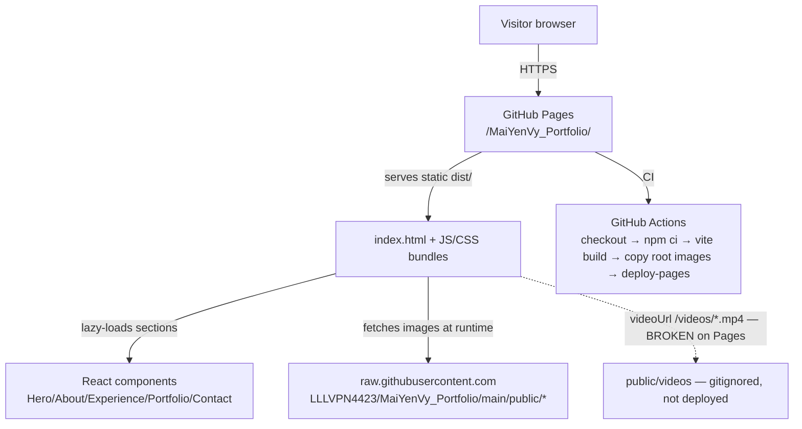

# Architecture

## System diagram

## Frontend architecture

- **No router.** Single-page layout; navigation is anchor scrolling (`href="#about"` etc.) with `scroll-behavior: smooth` in `src/index.css`.
- **Code splitting:** `App.jsx` lazy-loads each section via `React.lazy` + `Suspense` (one `Suspense` boundary per section). `Navbar` is eagerly imported.
- **Component tree:** `App` → `Navbar` + 5 lazy sections + footer.
- **State:** purely local `useState` inside components. No global state library, no context, no server state.
- **Portfolio internals** (`src/components/Portfolio.jsx`):
  - Custom hooks `useIntersectionObserver`, `useDebounce` defined in-file.
  - `LazyImage` component gates `` rendering behind IntersectionObserver.
  - Project data is a hardcoded array; gallery projects are generated by mapping filename arrays (`koreanFestivalImages`, `volunteerImages`, `btsImages`) to objects with `thumbnail`/`fullImage` pointing at GitHub raw URLs.
  - Filtering, client-side pagination (12/page), image lightbox modal, `<video>` modal.
- **Styling:** Tailwind utility classes + `tailwind.config.js` custom palette (`sea-blue`, `soft-beige`). No CSS modules, no styled-components. `index.css` holds base layer + scrollbar styling.
- **Media strategy:** images are NOT bundled; thumbnails/full images load at runtime from `raw.githubusercontent.com` (commit `256ee4e`, "bypass deployment issues"). Root-level copies of the 18 selected images are committed so the raw URLs resolve.

## Backend

**None.** No server code, no API routes, no serverless functions. All "backend" behavior is static file serving by GitHub Pages.

## Database / storage

**None.** No DB, no localStorage/IndexedDB usage (verified by grep — no occurrences). Content lives in JSX constants.

## Infrastructure

- GitHub Pages static hosting; Actions workflow `deploy.yml` (see PROJECT_OVERVIEW).
- Google Fonts (Inter, Playfair Display) loaded via `<link>` in `index.html` — external runtime dependency.
- GitHub raw content URL is a hardcoded runtime dependency for all imagery.

## Key dependency notes

- `framer-motion` used for all animations; `lucide-react` for icons.
- `@types/react`/`@types/react-dom` present but project is plain JSX (no TS, no ESLint/Prettier config, no tests).
- `npm audit --omit=dev`: **0 vulnerabilities** (verified 2026-11-05).
