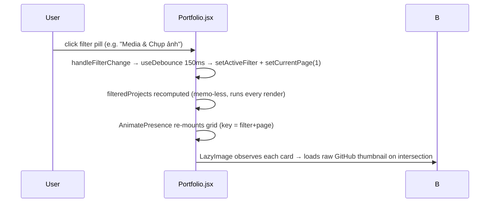

# Data Flow & System Interactions

This is a fully static site — there are **no API calls, no mutations, no persistence**. All "data flow" is render-time.

## Workflow 1: Initial page load

```mermaid
sequenceDiagram
    participant B as Browser
    participant GH as GitHub Pages
    participant RAW as raw.githubusercontent.com
    B->>GH: GET /MaiYenVy_Portfolio/
    GH-->>B: index.html + asset hashes (base path applied)
    B->>GH: GET /MaiYenVy_Portfolio/assets/index-*.js, *.css
    Note over B: main.jsx mounts React.StrictMode → App
    B->>B: Navbar renders eagerly; Hero/About/Experience/Portfolio/Contact lazy chunks fetch on demand
    B->>RAW: GET portrait.jpg, project thumbnails (only when scrolled into view via IntersectionObserver)
    RAW-->>B: images
```

Dead ends / risks in this flow:
- If the GitHub repo `LLLVPN4423/MaiYenVy_Portfolio` is renamed, made private, or branch `main` changes, **every image and the portrait 404** — the site renders with broken-image gray boxes (`LazyImage` pulse placeholder never resolves since `onLoad` never fires; `isLoaded` stays false → img stays `opacity-0`, showing only the gray pulse div — actually img is rendered with opacity-0 so user sees empty gray box).
- Google Fonts is a render-blocking external dependency; if fonts.googleapis.com is unreachable, fallback fonts apply (graceful).

## Workflow 2: Portfolio filtering



Notes:
- Filter change is debounced — rapid clicks collapse to last selection (intended).
- `filteredProjects`/`currentProjects` are recomputed on every render (no `useMemo`) — trivial cost at this data size.
- "Tất cả" path caps each category at 2 items — see FEATURE_INVENTORY F5.

## Workflow 3: Image lightbox

Click card (type `gallery`/`text`) → `setSelectedImage(fullImage||thumbnail)` → modal renders `` → click backdrop or X → `setSelectedImage(null)`. No Esc key, no focus trap, no body scroll-lock.

## Workflow 4: Video playback — BROKEN in production

Click video card → `setSelectedVideo('/videos/GALA - PHẦN 2.mp4')` → `<video controls autoPlay>` requests `/MaiYenVy_Portfolio/videos/GALA%20-%20PH%E1%BA%A6N%202.mp4` on Pages → **404** because `public/videos/` is gitignored and never reaches CI `dist/`. Locally it works because `public/videos` exists on disk. `videoError` state exists but is unused — no error UI shown; user sees a broken/empty player.

## Workflow 5: Navigation

Anchor `<a href="#about">` → browser native scroll (smooth via CSS). No JS router, no scroll-spy. Mobile menu closes on link click.

## External dependencies at runtime

| Dependency | Used for | Failure mode |
|---|---|---|
| `raw.githubusercontent.com/LLLVPN4423/MaiYenVy_Portfolio/main/public/*` | All portfolio images + portrait | Total image loss if repo private/renamed |
| `images.unsplash.com` (4 URLs) | creator/design placeholder thumbs | Broken thumbs for mock items only |
| `fonts.googleapis.com` / `fonts.gstatic.com` | Inter + Playfair Display | Fallback fonts |
| Facebook/Instagram/LinkedIn/Behance | Contact social buttons | Placeholder `yourprofile` URLs |
